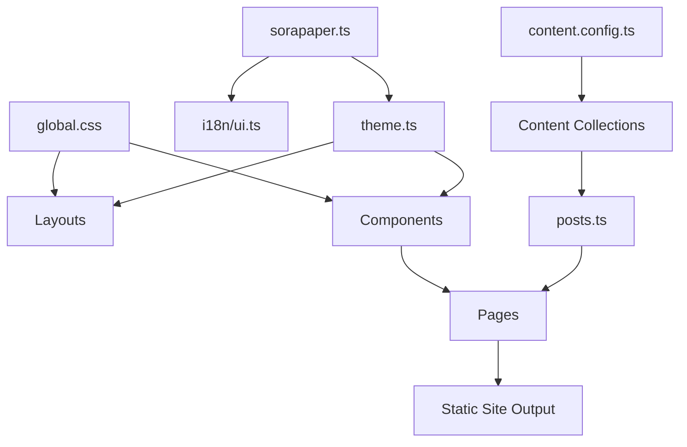

# SoraPaper 设计与开发文档

本文档面向后续开发人员和 LLM 维护者，用于在现有 SoraPaper Astro 主题基础上继续开发、修复 bug、替换视觉风格或接入新功能。

## 1. 项目目标

SoraPaper 是一个内容优先的 Astro 博客主题。它的设计基准是：

- Astro Paper 的简洁、轻量、长文阅读体验。
- Fuwari、Koharu、Yukina 一类主题的柔和渐变、玻璃卡片、圆角、低饱和氛围和轻装饰。
- 静态优先，默认少 JavaScript，不把个人博客做成重型前端应用。
- 可配置、可二次开发、可长期维护。

后续开发时不要偏离这几个方向。新增功能应优先保持主题轻量，视觉增强应服务于内容阅读，而不是抢占正文注意力。

## 2. 技术栈

当前项目使用：

- Astro：页面、路由、静态生成。
- Astro Content Collections：文章和友链内容建模。
- 主题内部 i18n：默认支持中文和英文，无可见语言前缀。
- MDX：允许文章中使用组件。
- CSS variables：设计 token、明暗主题、多主题色。
- 少量原生浏览器 JavaScript：搜索弹窗、主题切换、阅读进度条。
- RSS 和 sitemap Astro 集成。

当前 `package.json` 脚本：

```bash
npm install
npm run dev
npm run check
npm run build
npm run preview
```

注意：当前仓库依赖版本使用 `latest`，便于在真正开发环境中解析最新版本。正式发布主题前建议锁定版本并提交 lockfile。

## 3. 目录结构

```text
.
├─ astro.config.mjs
├─ package.json
├─ sorapaper.ts
├─ tsconfig.json
├─ README.md
├─ docs/
│  ├─ design-handoff.md
│  └─ development-guide.md
├─ public/
│  ├─ assets/
│  │  └─ social/
│  ├─ avatar.svg
│  ├─ favicon.svg
│  ├─ covers/
│  └─ friends/
└─ src/
   ├─ components/
   ├─ config/
   ├─ content/
   ├─ layouts/
   ├─ lib/
   ├─ pages/
   ├─ styles/
   └─ content.config.ts
```

关键目录职责：

- `sorapaper.ts`：用户统一配置入口，包括站点信息、默认 Open Graph 图片、作者、功能开关、Now 卡片和多语言页面文案。
- `src/config/theme.ts`：内部默认主题配置，会被 `sorapaper.ts` 强覆盖。
- `src/i18n/ui.ts`：内部默认本地化界面文案，会被 `sorapaper.ts.ui` 强覆盖。
- `src/styles/global.css`：全局样式和视觉 token，是视觉一致性的核心文件。
- `src/content.config.ts`：文章和友链的 Content Collections schema。
- `src/content/blog`：示例文章，支持 `.md` 和 `.mdx`。
- `src/content/friends`：友链内容。
- `src/lib/posts.ts`：文章查询、排序、slug、阅读时间、标签、归档、译文查找和相邻文章工具函数。
- `src/i18n`：语言配置、路径工具和界面文案翻译表。
- `src/layouts`：页面骨架，主要是全站布局和文章布局。
- `src/components`：可复用 UI 组件。
- `public/assets/social`：社交栏 SVG 图标资源，侧栏会根据 author link 的 `label` 或 `icon` 自动匹配。
- `src/pages`：Astro 文件路由。

## 4. 架构说明

整体数据流：



页面路由：

- `/`：首页，展示 Hero、最新文章、侧栏信息。
- `/posts/[...slug]/`：文章详情页。
- `/archive/`：归档页，按年份分组。
- `/tags/`：标签总览。
- `/tags/[tag]/`：标签详情页。
- `/about/`：关于页。
- `/friends/`：友链页。
- `/rss.xml`：RSS 输出。
- `/search.json`：静态搜索索引，客户端按当前语言过滤。

SEO 输出集中在 `src/layouts/BaseLayout.astro`：普通页面输出 canonical、Open Graph、Twitter Card 和默认分享图；文章页通过 `PostLayout.astro` 传入 article metadata，输出 `og:type=article`、发布时间、更新时间、标签和基于 `translationKey` 的 `hreflang` alternate links。RSS、搜索索引和 sitemap 仍使用无语言前缀的 clean routes。

组件分层：

- Layout：`BaseLayout.astro`、`PostLayout.astro`。
- Navigation：`SiteHeader.astro`、`SiteFooter.astro`。
- Content：`PostCard.astro`、`ArticleHeader.astro`、`TableOfContents.astro`。
- Home：`HeroSection.astro`、`Sidebar.astro`。
- Interaction：`ThemeToggle.astro`、`SearchDialog.astro`、`ScrollProgress.astro`。

## 5. 视觉系统

视觉系统集中在 `src/styles/global.css`。后续新增组件时，优先使用已有 token，不要随手写散落的颜色、阴影和圆角。

核心 token：

```css
--bg
--bg-soft
--surface
--surface-strong
--border
--text
--muted
--primary
--secondary
--accent
--tag
--code-bg
--radius-sm
--radius-md
--radius-lg
--radius-xl
--shadow-card
--shadow-soft
--container
--article
```

主题风格规则：

- 大面积背景使用低饱和渐变。
- 内容卡片默认使用 `.glass`。
- 文章正文宽度应接近 `--article`，不要过宽。
- Hover 效果应轻微，避免大幅缩放、强阴影或高饱和颜色。
- 深色模式必须同步检查，不要只在浅色模式下调样式。

主题色通过 `html[data-scheme]` 控制，当前包括：

- `paper`
- `sakura`
- `moon`
- `ocean`

明暗模式通过 `html[data-theme="dark"]` 控制。

## 6. 内容模型

文章 collection 位于 `src/content.config.ts`：

```ts
const blog = defineCollection({
  loader: glob({ base: "./src/content/blog", pattern: "**/*.{md,mdx}" }),
  schema: z.object({
    title: z.string(),
    description: z.string(),
    pubDate: z.coerce.date(),
    updatedDate: z.coerce.date().optional(),
    tags: z.array(z.string()).default([]),
    category: z.string().default("Notes"),
    draft: z.boolean().default(false),
    cover: imageMeta.optional(),
    series: z.string().optional(),
    toc: z.boolean().default(true),
    pinned: z.boolean().default(false)
  })
});
```

推荐文章 frontmatter：

```yaml
---
title: "文章标题"
description: "文章摘要，会显示在列表、SEO 和搜索结果中"
lang: zh
translationKey: astro-theme-design
pubDate: 2026-07-02
updatedDate: 2026-07-03
tags: ["Astro", "Design"]
category: "Frontend"
draft: false
cover:
  src: "/covers/sky.svg"
  alt: "封面图描述"
series: "Astro Theme"
pinned: true
toc: true
---
```

维护约定：

- `title`、`description`、`pubDate` 是必填字段。
- `lang` 当前支持 `zh` 和 `en`，用于文章过滤、搜索索引和 RSS 输出。
- 同一篇文章的不同语言版本应使用相同的 `translationKey`，便于后续实现文章互译跳转。
- `draft: true` 的文章不会进入列表和详情路由。
- `cover.alt` 必须可读，避免空 alt 描述用于重要封面。
- 标签命名要统一，例如不要混用 `frontend`、`Frontend`、`front-end`。
- `toc: false` 可用于短文或无标题层级文章。

友链 collection：

```yaml
---
name: "Astro"
description: "The web framework for content-driven websites."
href: "https://astro.build"
avatar: "/friends/astro.svg"
tags: ["Framework", "Frontend"]
---
```

## 7. i18n 实现说明

核心文件：

- `src/i18n/config.ts`：定义 `defaultLocale`、`locales`、语言名称、路径生成和语言切换工具。
- `src/i18n/ui.ts`：定义中文和英文默认界面文案，并用 `sorapaper.ts.ui` 覆盖。
- `src/layouts/BaseLayout.astro`：在首屏前读取 URL `?lang=` 或 `localStorage.locale`，设置 `html[data-locale]`。
- `src/components/SiteHeader.astro`：提供语言图标按钮，切换当前 locale；文章页会跳到对应译文 slug。

路由策略：

- 页面 URL 不带 `/zh` 或 `/en` 前缀。
- 首页、归档、标签、关于、友链等公共页面同时渲染中文和英文区块，通过 `html[data-locale]` 显示当前语言。
- 文章详情页按文章文件 slug 生成无前缀路径，语言切换时通过 `getTranslatedPost(post, posts, targetLocale)` 根据 `translationKey` 跳转到对应译文文章；没有译文时不跳转，只切换 `html[data-locale]` 和 `localStorage.locale`，并显示 `ui.{locale}.article.translationUnavailable` 提示。
- 文章列表通过 `getPublishedPosts(locale)` 按 frontmatter 的 `lang` 过滤。文章页使用同语言文章列表和 `getAdjacentPosts(posts, currentPost)` 生成上一篇/下一篇导航。
- 搜索索引输出所有文章，客户端按当前 `data-locale` 过滤结果。

路径工具：

- `localizePath(locale, path)`：保留内部链接为无前缀路径，参数用于兼容调用位置。
- `switchLocalePath(targetLocale, currentPath)`：生成带 `?lang=` 的兼容切换链接，主要用于非 JS fallback。
- `getLocaleFromParams(Astro.params)`：保留给未来动态语言路由兼容，当前主要使用 `localStorage.locale`。

新增语言时需要：

1. 在 `src/i18n/config.ts` 增加 locale 类型。
2. 在 `sorapaper.ts` 增加完整界面文案。
3. 在 `src/content.config.ts` 扩展 `lang` enum。
4. 添加对应语言文章内容。
5. 检查导航、搜索、RSS、归档、标签页是否支持新语言显示和过滤。

## 8. 页面实现说明

### 首页

入口：`src/pages/index.astro`

职责：

- 调用 `getPublishedPosts(locale)` 获取当前语言文章。
- 调用 `getPinnedPosts(locale)` 获取当前语言置顶文章。
- 调用 `getAllTags()` 生成标签侧栏。
- 组合 `HeroSection`、`PostCard` 和 `Sidebar`。

修改首页布局时注意：

- 桌面端保持文章列表 + 右侧栏。
- 移动端侧栏必须下沉。
- Hero 可以有视觉装饰，但不能影响首屏阅读层级。

### 文章页

入口：`src/pages/posts/[...slug].astro`

职责：

- 使用 `getStaticPaths()` 为已发布文章生成静态路由。
- 使用 `render(post)` 渲染 Markdown/MDX。
- 将 `post` 和 `headings` 传入 `PostLayout`。

布局：`src/layouts/PostLayout.astro`

注意：

- TOC 依赖 `render(post)` 返回的 `headings`。
- `post.data.toc` 控制是否显示目录。
- 正文样式由 `.article-content` 提供。

### 归档与标签

入口：

- `src/pages/archive.astro`
- `src/pages/tags/index.astro`
- `src/pages/tags/[tag].astro`

工具函数：

- `getArchiveGroups(posts)`
- `getAllTags(posts)`

新增筛选、分页或分类页面时，优先在 `src/lib/posts.ts` 扩展工具函数，避免每个页面重复实现。

### 关于与友链

入口：

- `src/pages/about.astro`
- `src/pages/friends.astro`

关于页读取 `themeConfig.author`。友链页读取 `friends` collection。

## 9. 核心工具函数

文件：`src/lib/posts.ts`

已有函数：

- `getPublishedPosts(locale)`：读取指定语言的非草稿文章，按发布时间倒序。
- `getPinnedPosts(locale)`：返回指定语言的置顶文章。
- `getPostSlug(post)`：从 content entry id 得到 slug。
- `getPostHref(post)`：生成无语言前缀的文章链接。
- `getReadingTime(body, locale)`：按中英文混合内容粗略计算本地化阅读时间。
- `formatDate(date, locale)`：按当前语言格式化日期。
- `getAllTags(posts)`：生成标签计数和 slug。
- `getArchiveGroups(posts)`：按年份分组文章。

常见扩展：

- 分类页：新增 `getAllCategories(posts)`。
- 系列页：新增 `getSeriesGroups(posts)`。
- 分页：新增 `paginatePosts(posts, page, pageSize)`。
- 相邻文章：新增 `getAdjacentPosts(posts, currentPost)`。

## 10. 交互功能

### 明暗模式

组件：`src/components/ThemeToggle.astro`

机制：

- 使用 `localStorage.theme` 保存用户选择。
- `BaseLayout.astro` 内联脚本在页面加载前读取设置，减少主题闪烁。
- 深色样式由 `:root[data-theme="dark"]` 提供。

修改建议：

- 新增样式时必须同时考虑深色模式。
- 不要在组件里硬编码深色颜色，优先扩展 token。

### 多主题色

组件：`src/components/SiteHeader.astro`

机制：

- 点击色彩按钮循环 `paper`、`sakura`、`moon`、`ocean`。
- 当前值保存在 `localStorage.scheme`。
- CSS 通过 `:root[data-scheme="..."]` 修改 `--primary`、`--secondary`、`--accent`。

### 搜索

组件：`src/components/SearchDialog.astro`

索引：`src/pages/search.json.ts`

机制：

- `/search.json` 输出所有语言文章的标题、摘要、标签、链接和 `lang` 字段。
- 客户端根据当前 `html[data-locale]` 过滤搜索结果。
- 客户端打开搜索弹窗时懒加载 JSON。
- 使用原生 `includes()` 做轻量过滤。

后续升级：

- 小站点继续使用当前实现。
- 文章数量较多时可替换为 Pagefind。
- 替换时保持 `SearchDialog` 对外入口不变，减少影响范围。

### 阅读进度条

组件：`src/components/ScrollProgress.astro`

机制：

- 监听 `scroll` 和 `resize`。
- 通过 `scaleX()` 更新顶部进度条。

如果页面出现性能问题，优先检查这里和搜索组件的事件监听。

## 11. 样式开发规范

新增组件时建议：

1. 先确认是否已有组件可以复用。
2. 使用 `.glass`、`.pill`、`.container`、`.section-title`、`.muted` 等全局工具类。
3. 局部样式写在 Astro 组件 `<style>` 中。
4. 颜色、圆角、阴影、宽度使用 token。
5. 移动端断点优先参考已有组件的 `680px`、`760px`、`780px`、`860px`、`940px`、`1080px`。

避免：

- 在多个组件里复制相同复杂样式。
- 为单个按钮写完全不同的交互语言。
- 使用高饱和背景破坏柔和风格。
- 让正文容器过宽。
- 让装饰元素遮挡正文或产生横向滚动。

## 12. 常见二次开发任务

### 修改站点信息

优先编辑根目录 `sorapaper.ts`：

- 站点名称：`name`
- 站点描述：`description`
- 作者信息：`author`
- Now 卡片：`now`
- 功能开关：`featureFlags`
- 导航文案。
- 首页 Hero 文案。
- 页面标题、搜索文案、文章页文案和页脚文案。

`src/config/theme.ts` 和 `src/i18n/ui.ts` 是内部默认值文件。只有在维护主题默认行为时才修改它们；普通用户配置应写在 `sorapaper.ts`。

### 新增文章

在 `src/content/blog` 下创建 `.md` 或 `.mdx` 文件，填写 frontmatter。开发前运行：

```bash
npm run check
```

### 新增页面

在 `src/pages` 下创建 Astro 文件。建议：

- 使用 `BaseLayout` 包裹页面。
- 使用 `container` 保持宽度一致。
- 页面头部样式参考 `archive.astro` 或 `tags/index.astro`。

### 新增卡片组件

在 `src/components` 下创建组件。建议：

- 使用 `glass` 作为基础视觉。
- 圆角使用 `--radius-md` 或 `--radius-lg`。
- hover 只做轻微 `translateY` 或边框色变化。

### 新增社交链接或图标

社交栏配置优先写在 `sorapaper.ts` 的 `author.links`：

```ts
links: [
  { label: "GitHub", href: "https://github.com/" },
  { label: "Email", href: "mailto:hello@example.com" },
  { label: "WeChat", href: "#wechat" },
  { label: "My Site", href: "https://example.com", icon: "website" }
]
```

侧栏会先读取 `icon`，没有 `icon` 时根据 `label` 自动匹配 `public/assets/social/*.svg`。常见内置图标包括 `github`、`email`、`x`、`wechat`、`bilibili`、`discord`、`telegram`、`linkedin`、`instagram`、`youtube`、`facebook`、`gitlab`、`rss`、`website`、`mastodon` 和 `juejin`。

新增平台时，把同名 SVG 放到 `public/assets/social/<icon>.svg`，再在 `sorapaper.ts` 中使用 `icon: "<icon>"`。

### 新增评论系统

建议创建：

```text
src/components/Comments.astro
src/lib/comments.ts
```

并在 `themeConfig.featureFlags.comments` 控制启用。不要默认加载第三方脚本。

### 新增 Pagefind 搜索

建议步骤：

1. 保留 `SearchDialog.astro` 作为 UI。
2. 添加 Pagefind 构建脚本。
3. 将搜索逻辑从 `/search.json` 切换到 Pagefind API，并保留按当前 locale 过滤的行为。
4. 保留当前轻量搜索作为 fallback 或删除无用代码。

### 新增 Open Graph 图片

建议创建专门的 OG 生成路由或脚本，不要把 OG 逻辑塞进文章页布局。OG 样式应复用主题 token。

## 13. Bug 修复指南

### 页面构建失败

优先检查：

- frontmatter 是否符合 `src/content.config.ts`。
- 日期是否能被 `z.coerce.date()` 解析。
- `cover` 是否包含 `src` 和 `alt`。
- MDX 中是否使用了未导入组件。

命令：

```bash
npm run check
npm run build
```

### 文章不显示

检查：

- `draft` 是否为 `true`。
- 文件是否在 `src/content/blog`。
- 文件后缀是否是 `.md` 或 `.mdx`。
- 是否缺少必填 frontmatter。

### 标签页 404

检查：

- 标签大小写是否混乱。
- `getAllTags()` 生成的 slug 是否和链接一致。
- 标签中是否包含特殊字符。当前使用 `encodeURIComponent(tag.toLowerCase())`，复杂标签可能需要更稳定的 slugify 策略。

### 搜索无结果

检查：

- 搜索索引是否能访问：`/search.json`。
- 当前 `html[data-locale]` 是否符合预期。
- 文章是否为草稿。
- 搜索内容是否在标题、摘要或标签中。
- 浏览器控制台是否有 JSON 解析或 fetch 错误。

### 主题切换闪烁

检查：

- `BaseLayout.astro` 的内联脚本是否仍在 `<head>` 中。
- 是否有组件在加载后覆盖了 `data-theme`。
- 是否引入了不受 token 控制的硬编码背景色。

### 移动端横向滚动

优先检查：

- 装饰元素是否超出容器。
- `pre`、`table`、图片是否没有设置 overflow 或 max-width。
- 新增组件是否写了固定宽度。

### 深色模式不可读

检查：

- 是否使用了硬编码浅色背景或深色文字。
- 新组件是否依赖 `--surface`、`--text`、`--muted`。
- 代码块、引用块、标签是否复用全局样式。

## 14. LLM 维护指南

如果由 LLM 继续开发，请遵守：

- 先读 `README.md`、`docs/design-handoff.md`、本文档和相关组件，再修改。
- 不要修改计划文件。
- 不要随意引入大型依赖。新增依赖前说明原因和替代方案。
- 不要把所有功能塞进单个组件，优先保持现有分层。
- 修改视觉时优先改 token，而不是逐个组件打补丁。
- 修改内容模型时同步更新示例文章和本文档。
- 修 bug 时先定位最小影响范围，不要顺手重构无关页面。
- 每次改动后至少运行 `npm run check`；发布前运行 `npm run build`。
- 如果当前环境没有 Node/npm，应在最终说明中明确无法验证。

LLM 推荐排查顺序：

1. 读报错栈或用户截图。
2. 定位对应路由文件。
3. 查看它依赖的组件和 `src/lib/posts.ts`。
4. 检查 content schema 和示例内容。
5. 做最小修复。
6. 运行 check/build。
7. 总结改动、验证结果和剩余风险。

## 15. 验收清单

功能验收：

- 首页可打开，文章列表正常。
- 文章页可打开，Markdown/MDX 渲染正常。
- 归档页、标签页、关于页、友链页可打开。
- `/rss.xml` 可访问。
- `/search.json` 可访问。
- 搜索弹窗可打开并返回结果。
- 明暗模式可切换并持久化。
- 主题色可切换并持久化。
- 阅读进度条工作正常。

视觉验收：

- 首页接近预览图：柔和渐变、玻璃卡片、清晰层级。
- 正文宽度适合长文阅读。
- 代码块、引用、表格、图片不破版。
- 375px 移动端无横向滚动。
- 深色模式对比度可读。
- Hover 和动效克制。

工程验收：

- `npm run check` 通过。
- `npm run build` 通过。
- Lighthouse Performance 目标 90+。
- 新增样式使用 token。
- 新增内容符合 Content Collections schema。
- 文档同步更新。

## 16. 后续路线建议

短期：

- 锁定依赖版本并提交 lockfile。
- 接入 Pagefind 或保留轻量搜索并补键盘快捷键。
- 给文章页补上一篇/下一篇。
- 给 SEO 增加 canonical、Open Graph 图片和 Twitter Card。

中期：

- 增加分类页和系列文章页。
- 增加评论适配层，支持 Giscus/Twikoo/Waline。
- 增加主题配置文档页面。
- 增加示例站点截图和部署指南。

长期：

- 抽成可复用 Astro theme template。
- 增加主题 CLI 初始化脚本。
- 建立视觉回归截图测试。
- 为内容 schema 做迁移说明和版本化。
